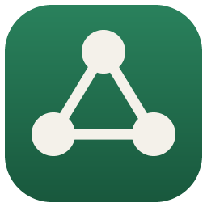
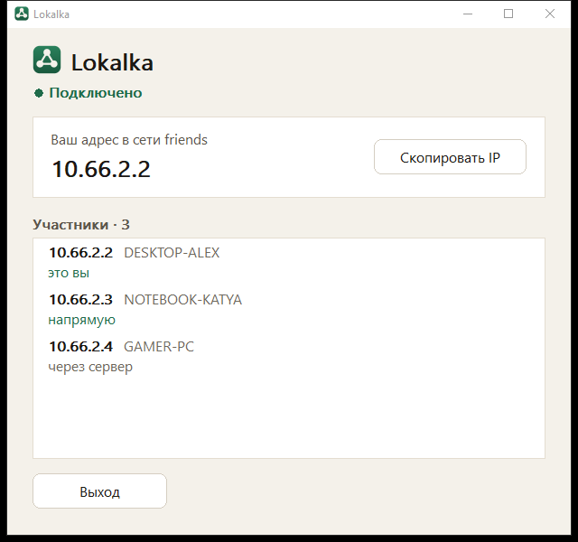
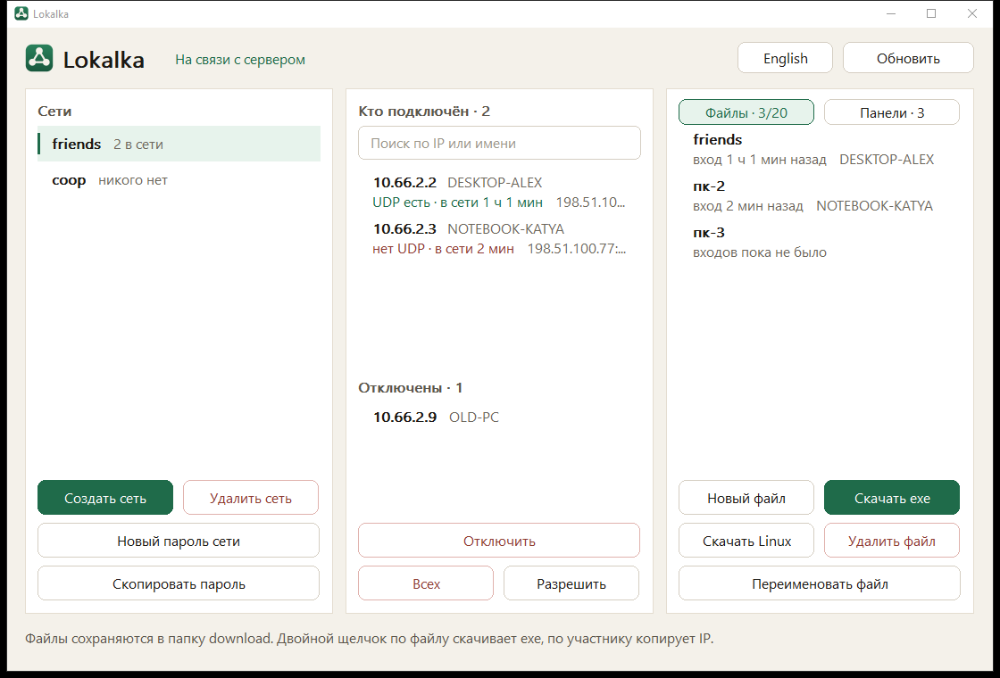
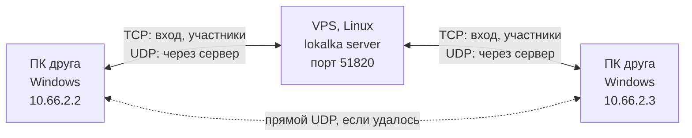
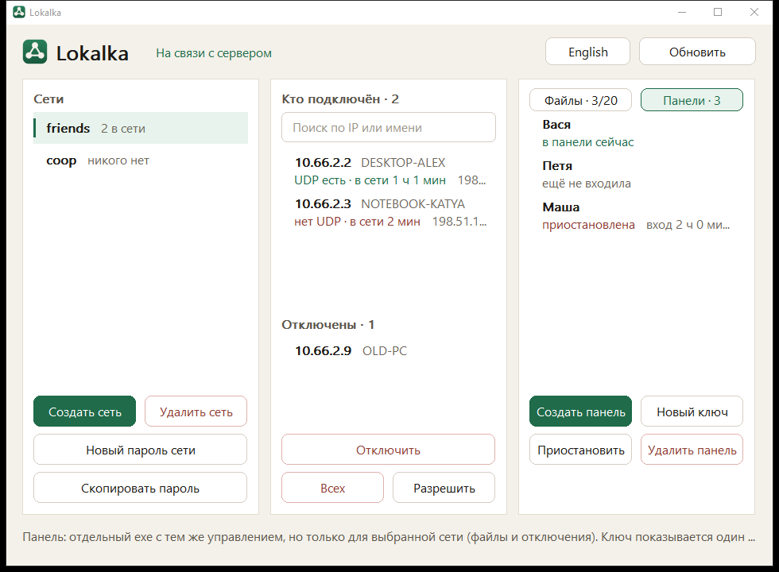

<p align="center">
  <b>Русский</b> | <a href="README.en.md">English</a>
</p>

<p align="center">
  
</p>

<h1 align="center">Lokalka</h1>

<p align="center">
  Локальная сеть для игр с друзьями через свой сервер. Как Radmin VPN или Hamachi, только сервер ваш.
</p>

<p align="center">
  
</p>

Друг запускает присланный ему `.exe`, подтверждает права администратора, и его компьютер оказывается в одной локальной сети с остальными: адреса вида `10.66.X.Y`, работает поиск игр по LAN и широковещание. Интернет-трафик в туннель не уходит.

## Возможности

- **Один файл для входа.** Админка собирает для каждого участника готовый `.exe` с адресом сервера, сетью и паролем внутри. Ничего не нужно настраивать и устанавливать.
- **Напрямую, когда получается.** Участники пробивают UDP друг к другу; если не вышло, пакеты идут через сервер.
- **Шифрование.** Трафик между участниками шифруется AES-GCM с ключом пары. Сервер пересылает пакеты, не расшифровывая их.
- **Проверка сервера.** Сервер подписывает рукопожатие постоянным ключом ed25519, а его открытая часть вшита в каждый файл входа. Подменить сервер по дороге и узнать пароль не выйдет.
- **Админка в обычном окне Windows.** Сети, кто сейчас подключён, отключение и возврат участников, файлы для входа.
- **Панели для помощников.** Можно выдать человеку отдельный exe, который управляет только одной сетью: видит участников и выпускает файлы входа, но не трогает пароль и другие сети.
- **Стабильные адреса.** Один и тот же компьютер всегда получает в сети тот же IP.
- **Только стандартная библиотека Go.** Без сторонних зависимостей и без CGO.

<p align="center">
  
</p>

## Как это устроено



- У каждой сети своя подсеть `10.66.X.0/24`. Адрес `.1` занят, участники получают адреса с `.2` по `.254` по имени компьютера.
- На Windows клиент поднимает адаптер `Lokalka` через [Wintun](https://www.wintun.net/): без шлюза, с низким приоритетом маршрутов, MTU 1280. Маршрут по умолчанию не меняется.
- Управление идёт по TCP: X25519 → HKDF → AES-GCM со своим ключом и счётчиком кадров на каждое направление, сервер подписывает рукопожатие ed25519. Повторить, переставить или отразить кадр нельзя.
- Данные идут по UDP на том же порту. Адрес участника сервер и другие участники меняют только по пакетам со свежим счётчиком, поэтому перехваченный пакет, присланный с чужого адреса, не уведёт трафик.
- На Windows `wintun.dll` распаковывается в `Program Files\Lokalka`, куда пишет только администратор, а библиотеки ищутся только в System32: программа с правами пользователя не подсунет свою DLL процессу, получившему права через UAC.

## Что нужно

| | |
|---|---|
| Сервер | Linux x86-64 с публичным IP, открытые TCP и UDP `51820` |
| Участники | Windows 10/11 x64 с правами администратора (нужны для адаптера). Есть и консольный клиент для Linux: запуск от root |
| Сборка | Go 1.27, Windows PowerShell 5.1 для скрипта сборки |

## Быстрый старт

### 1. Сервер

На Linux-сервере с systemd:

```sh
curl -fsSL https://raw.githubusercontent.com/0fells/lokalka/main/scripts/install-server.sh | sudo bash
```

Скрипт скачает сервер из [релиза](https://github.com/0fells/lokalka/releases), сверит контрольную сумму, настроит systemd и файрвол и в конце покажет адрес сервера и пароль админки. Откройте TCP и UDP `51820` и в панели хостинга, если там есть свой файрвол.

Подробно, вручную, с переносом, обновлением и разбором неполадок: **[docs/install.md](docs/install.md)**.

> **Берегите `/var/lib/lokalka/state.json`.** В нём ключ сервера. Если его потерять, все розданные exe перестанут подключаться и их придётся выпустить заново.

### 2. Админка

Скачайте `Lokalka.exe` из [релиза](https://github.com/0fells/lokalka/releases) на компьютер с Windows и запустите. Введите адрес сервера (`IP:51820`, порт можно не указывать) и пароль админки. При первом входе админка, ещё не отправив пароль, покажет ключ сервера: сверьте его с тем, что напечатала установка, и подтвердите.

### 3. Сети и файлы для друзей

1. "Создать сеть": имя (латиница, цифры, `_`, `-`) и пароль.
2. В карточке "Файлы для входа" нажмите "Новый файл", затем "Скачать exe". Готовый файл появится в папке `download` рядом с `Lokalka.exe`.
3. Отправьте этот exe другу. Он запускает его, нажимает "Да" в окне Windows, и он в сети.

<p align="center">
  
</p>

### Клиент для Linux

"Скачать Linux" в админке собирает такой же файл входа для Linux (для этого рядом с `Lokalka.exe` должен лежать `lokalka-linux-amd64` из релиза):

```sh
chmod +x Имя-linux-amd64
sudo ./Имя-linux-amd64
```

Или без файла, флагами:

```sh
sudo lokalka join --server ВАШ_IP:51820 --net friends --password ПАРОЛЬ
```

### Веб-админка

Запасной вариант на случай, когда окна админки нет под рукой. Она слушает только localhost сервера, поэтому открывается через SSH-туннель:

```sh
ssh -N -L 8756:127.0.0.1:8756 root@ВАШ_IP
```

Затем откройте `http://127.0.0.1:8756`. Запросы с других адресов и страниц она отклоняет. В Windows то же самое делает `scripts\web-admin.bat root@ВАШ_IP`.

## Сборка из исходников

```powershell
.\scripts\build.ps1
```

Нужен Go 1.27. Скрипт прогоняет тесты и кладёт в `admin\` админку `Lokalka.exe` и `lokalka-linux-amd64` (сервер и клиент для Linux). Драйвер `wintun.dll` вшивается в exe; если его нет в `internal\tun\`, скрипт скачает его с wintun.net. Чтобы в окне входа админки сразу стоял адрес вашего сервера: `$env:LOKALKA_DEFAULT_SERVER = "203.0.113.10:51820"` перед сборкой.

## Разработка

```sh
go test ./...                      # все тесты
go vet ./...
go run ./tools/winres              # перерисовать иконку и ресурс exe
```

Снимки окон без сервера, чтобы проверить вёрстку:

```powershell
$env:LOKALKA_UI_SNAPSHOT = "$env:TEMP\shots"
go test -run Snapshot -count=1 -v ./cmd/lokalka/
```

### Структура

```
cmd/lokalka/        точка входа: клиент, админка, панель, сервер; окна Win32
internal/vpn/       клиент, сервер, сессии админки и панели
internal/proto/     рукопожатие, кадры, датаграммы
internal/crypto/    X25519, HKDF, AES-GCM, HMAC
internal/store/     сети, адреса, файлы входа, панели, ключ сервера (state.json)
internal/stamp/     настройки, дописанные в конец exe
internal/tun/       адаптер: wintun на Windows, /dev/net/tun на Linux
internal/admin/     веб-админка
tools/winres/       генератор иконки и ресурса Windows
scripts/            сборка и загрузка wintun
```

Файл входа является копией программы, к концу которой дописан JSON с адресом сервера, его ключом, именем сети и паролем. Windows его не читает, а программа при старте находит его и сразу входит в сеть.

## Ограничения

- Только IPv4 и только L3: широковещание и мультикаст подсети пересылаются, но это не полноценный L2-мост.
- Пароль у всех файлов сети общий. Удаление файла не закрывает доступ тому, у кого он уже есть: для этого смените пароль сети и раздайте новые файлы.
- Панель выпускает файлы входа, а в них лежит пароль сети. После того как вы удалили или приостановили панель, смените пароль сети, если не доверяете её владельцу.
- Отключение участника привязано к имени компьютера. Выданные адреса не освобождаются: сеть рассчитана на компанию друзей, а не на сотни разных компьютеров.
- Ключи участников раздаёт сервер, поэтому ему нужно доверять. Это ваш сервер.
- До 64 участников онлайн и до 20 файлов входа в сети.
- Окна есть только в Windows. В Linux есть консольный клиент и сервер.

## Лицензия

[MIT](LICENSE).

## Сторонние компоненты

В программу вшит [Wintun](https://www.wintun.net/), драйвер виртуального адаптера от WireGuard LLC. Он распространяется в неизменном виде под [своей лицензией](https://www.wintun.net/), её условия относятся к `wintun.dll`.
